# RIP-Evidence

**多源程序证据引导的大语言模型变异单元测试生成**

中文说明 | [English](README.md)

RIP-Evidence 是一个面向 Java 目标变异体的证据引导单元测试生成框架。它不只向大语言模型提供源码或变异反馈，而是通过静态分析构造杀死目标变异体所需的程序证据：**到达（Reach）**变异位置、**感染（Infect）**程序状态、将行为差异**传播（Propagate）**到可观察位置，并最终生成可编译、可执行且具有有效断言的 JUnit 测试。

本仓库包含方法实现、基线复现、实验数据，以及论文中的全部 **7 幅图**和 **15 张表**。

> 论文状态：审稿中。仓库中的实现与实验产物仍可能围绕可复现性继续更新。

## 项目概览

- **任务：** 为 Java 目标变异体定向生成能够杀死该变异体的单元测试。
- **核心思想：** 将变异语义、RIP 证据、可调用入口提升、对象构造/API 约束、可观察行为和编译反馈压缩为结构化 `PromptEvidence`。
- **实验规模：** 12 个 Java 项目、125,157 个变异体，其中 106,130 个已标注非等价变异体作为测试生成目标。
- **主要结果：** 编译成功率 98.55%，执行成功率 97.08%，套件级变异得分 84.22%，目标变异体杀死率 70.89%。
- **相对提升：** 相比最优可比 LLM 基线，编译成功率提高 17.27 个百分点，变异得分提高 12.58 个百分点。
- **真实缺陷：** 在严格映射且可执行的 Defects4J v3.0.1 缺陷上达到 64.29% 的检测率。

## 摘要

变异测试通过检查测试能否区分原程序和变异程序来评估测试套件的缺陷检测能力。为特定目标变异体自动生成测试并不容易，因为覆盖变异语句并不足以杀死变异体：测试还必须到达变异位置、触发内部状态差异、将差异传播到可观察行为，并构造有效的测试预言。直接使用 LLM 还会受到入口不可访问、对象构造错误、API 幻觉、断言薄弱和编译失败等问题影响。

RIP-Evidence 通过静态分析构造变异语义、调用入口、receiver 构造、可用 API、RIP 条件和可观察行为等多源证据，并将其压缩为 `PromptEvidence`。这些结构化证据引导 LLM 生成变异敏感的 JUnit 测试，编译和执行诊断则用于定向修复。

## 方法

### 动机：杀死变异体不等于覆盖变异语句

动机示例区分了真实变异方法 `A` 与可调用测试入口 `B`。成功的测试需要合法调用 `B`，到达并感染 `A`，将差异传播到可观察位置，再通过断言暴露该差异。典型失败包括直接调用不可访问方法、输入未进入变异分支，以及缺少能够观察行为差异的断言。

<p align="center">
  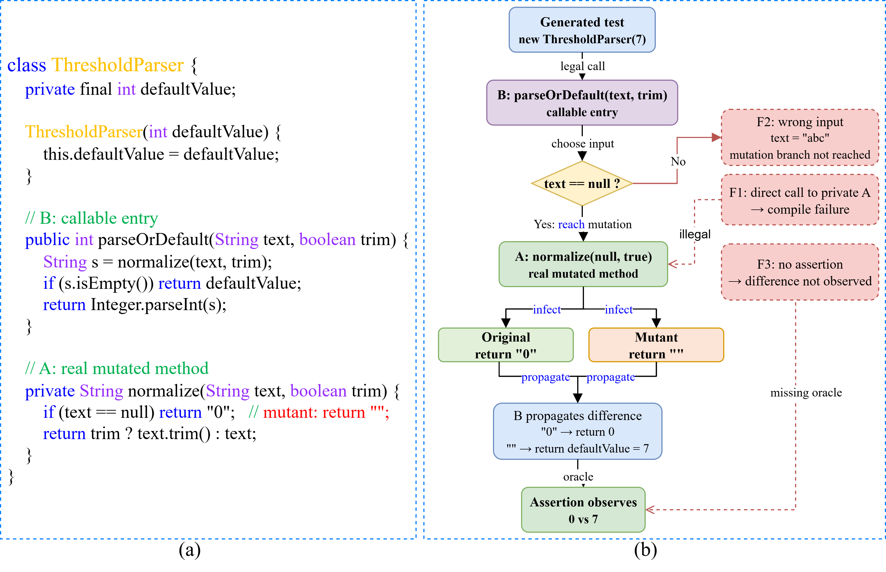
</p>

**图 1.** 变异单元测试生成中的调用入口、传播路径和典型失败模式。

### 端到端流程

RIP-Evidence 包含四个主要阶段：

1. **变异定位与候选区域识别：** 将源码级 AST 变化与原程序、变异程序中受影响的 Jimple 语句对齐。
2. **多源证据构造：** 构造变异语义、基于 CFG/DFG 的 Reach–Infect–Propagate 证据、可调用入口、receiver 构造、public API 约束和可观察/断言计划。
3. **预算感知的 `PromptEvidence` 组装：** 优先保留变异、调用、预言和编译关键证据，压缩重复路径和低优先级上下文。
4. **LLM 生成与修复：** 生成 JUnit 测试并进行编译，根据失败分类构造定向修复提示。

<p align="center">
  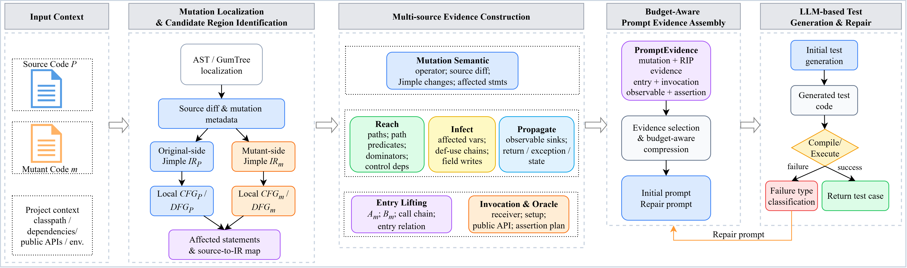
</p>

**图 2.** RIP-Evidence 的总体工作流程。

### 入口提升

当真实变异方法 `A` 为 private、不可访问、抽象方法，或只能通过间接调用链到达时，框架会搜索合法可调用入口 `B`，并构造 `B → A` 调用链、receiver/环境设置、输入约束、可观察汇点和断言计划。

<p align="center">
  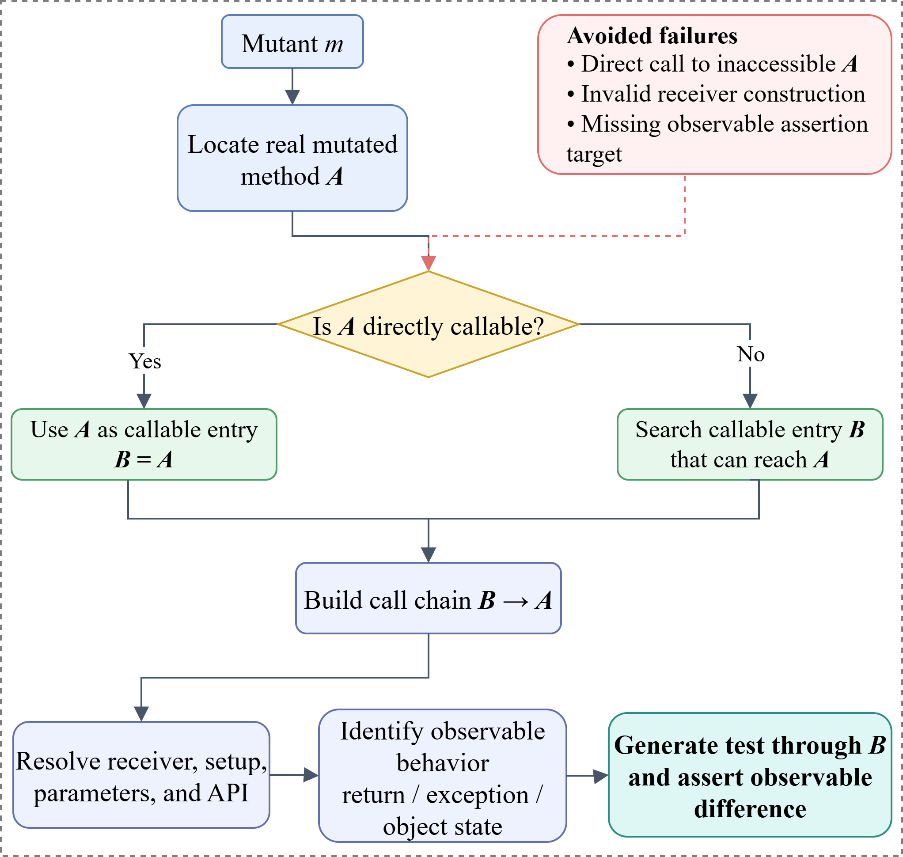
</p>

**图 3.** 面向可调用测试的入口提升机制。

### 证据层次

`PromptEvidence` 将多源程序证据按层次组织，而不是把原始程序分析结果直接发送给 LLM。

<p align="center">
  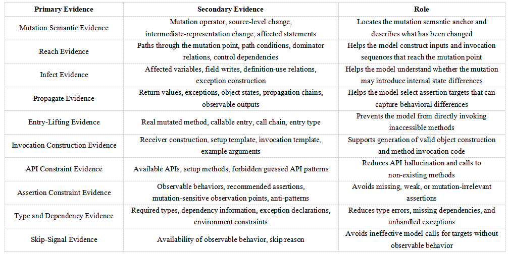
</p>

**表 1.** 多源程序证据的层次化组织及其作用。

## 仓库结构

```text
MutantsTestLLM/
├── EvidenceParse/   # 多源证据构造，输出 graph/output.json
├── MuTestLLM/       # MuJava 扩展、PromptEvidence、LLM 生成/修复/评估
├── Baselines/       # 7 个 LLM 基线和 2 个传统自动测试生成基线
├── data/            # 实验工作簿、派生统计结果和分析脚本
├── figs/            # 论文图 Fig1–Fig7、表 Table1–Table15
├── README.md        # 英文说明
└── README-zh.md     # 中文说明
```

组件文档：

- [`EvidenceParse/README_zh.md`](EvidenceParse/README_zh.md)：证据模式、Excel 输入、批处理模式和 `output.json` 生成。
- [`EvidenceParse/README.md`](EvidenceParse/README.md)：证据构造工具英文说明。
- [`MuTestLLM/README.md`](MuTestLLM/README.md)：MuJava 集成、LLM 配置、生成、编译修复、执行与结果收集。
- [`Baselines/README_CN.md`](Baselines/README_CN.md)：统一基线协议与中文运行手册。
- [`Baselines/README_EN.md`](Baselines/README_EN.md)：基线复现英文说明。
- [`Baselines/data/README.md`](Baselines/data/README.md)：目标清单与数据字段。

## 环境要求

主要实现面向 Windows/PowerShell 研究环境，以及能够由 MuJava 处理的 Java 项目。

- JDK 8，或与目标项目兼容的 JDK
- Maven 3.x
- Python 3.8+，用于基线适配器和分析脚本
- 足够的 Soot 分析内存；参考的大规模命令使用 `-Xmx16g`
- 用于 LLM 测试生成的 OpenAI 兼容 Chat Completions 接口
- 目标项目源码、已编译 class、依赖库和变异体目录

请勿提交 API Key。密钥应写入组件文档所述的本地忽略配置文件。

## 构建

在仓库根目录构建两个 Java 组件：

```powershell
mvn -f EvidenceParse/pom.xml clean package -DskipTests
mvn -f MuTestLLM/pom.xml clean package -DskipTests
```

正式运行前，需要根据本地项目配置以下文件中的路径和依赖：

- `MuTestLLM/mujava.config`
- `MuTestLLM/mujavaCLI.config`
- `MuTestLLM/libraries.json`
- `MuTestLLM/README.md` 中说明的本地 LLM 配置

运行基线实验时，请按照 `Baselines/README_CN.md` 复制并修改 `Baselines/configs/` 下的模板。

## 复现流程

Excel 工作簿是整个实验的中心索引，用于关联变异体所属项目、源码路径、变异算子、目标方法、结构化证据、生成测试和评估结果。

### 1. 生成变异体

使用 `MuTestLLM` 中的 MuJava 入口生成并编译传统方法级变异体：

```powershell
java -cp <classpath> mujava.TraditionalMutantsGeneratorCLI <args>
```

### 2. 构造 `output.json` 证据

大规模运行推荐使用 process 模式，以获得 worker 隔离并摊销 Soot/JVM 启动开销：

```powershell
java -Xmx16g -cp <evidence-classpath> org.OutputJsonBatchRunner `
  --excel <mutant-metadata.xlsx> `
  --mode process `
  --workers 8 `
  --rewrite true `
  --rowStart 1 `
  --rowEnd -1
```

每个变异体的预期证据产物为：

```text
<mutantDir>/graph/output.json
```

调试时可使用 `--mode single`。Excel 字段、退出码和日志结构详见 `EvidenceParse/README_zh.md`。

### 3. 生成并编译 JUnit 测试

```powershell
java -Xmx16g `
  -Dmujava.config.path=<mujava.config> `
  -Dllm.provider=<provider> `
  -Dllm.threads=4 `
  -cp <mutest-classpath> `
  mujava.testgenerator.LLMTestGeneratorBatch <mutant-metadata.xlsx>
```

生成器读取 `output.json`，构造预算感知的 `PromptEvidence`，调用已配置模型，提取 Java 代码并编译；若编译失败，则根据诊断信息进行定向修复。

### 4. 在原程序和变异程序上执行测试

```powershell
java -Xmx16g -cp <mutest-classpath> `
  mujava.testgenerator.LLMTestExecutor <mutant-metadata.xlsx> 5000
```

第二个参数为毫秒级超时时间。执行器同时报告目标级杀死结果和套件级变异得分。

### 5. 收集结果

代表性输出如下：

```text
<resultModuleHome>/llm/
├── src/
├── classes/
└── report/
    ├── llm_generation_results.jsonl
    ├── <TestName>__compact_evidence.json
    ├── <TestName>__prompt.txt
    ├── <TestName>__response_0.json
    ├── <TestName>__compile_error_0.txt
    └── <TestName>__generation_summary.txt

<resultModuleHome>/llm/execution-report/<runId>/
├── llm_target_kill_results.csv
├── llm_suite_kill_results.json
├── all_method_summary.csv
├── all_class_summary.csv
└── llm_execution_summary.txt
```

结果合并、已编译测试恢复和失败分析工具详见 `MuTestLLM/README.md`。

## 实验设计

### 研究问题

- **RQ1——项目级有效性：** 不同项目与方法生成的测试在可用性和变异检测能力上表现如何？
- **RQ2——算子级稳定性：** 方法在不同变异算子上的杀死能力是否稳定？
- **RQ3——效率与成本：** 证据构造、生成、修复、执行、Token 和 API 成本如何？
- **RQ4——跨模型有效性：** 结构化证据在不同 LLM backbone 上是否持续有效？

### 数据集

实验包含 12 个 Java 项目，共 84,672 行代码、3,304 个类和 8,137 个方法。MuJava 使用 19 个传统变异算子生成 125,157 个变异体；排除 19,027 个已标注等价变异体后，剩余 106,130 个非等价变异体作为测试生成目标。

<p align="center">
  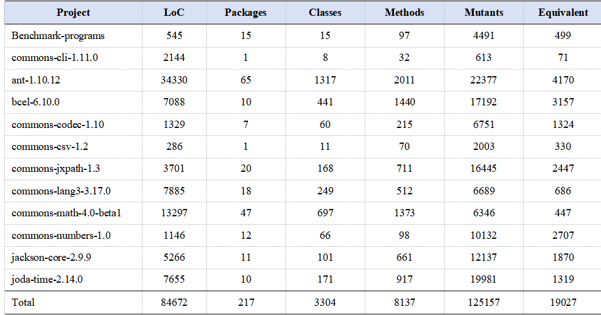
</p>

**表 2.** 实验项目与生成变异体的统计信息。

<p align="center">
  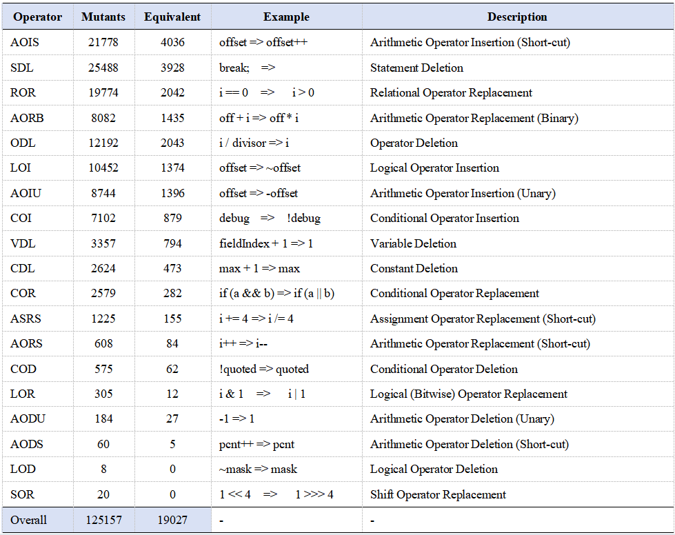
</p>

**表 3.** 实验所用变异算子的统计信息。

公开数据集存档于 [Zenodo（DOI: 10.5281/zenodo.20593500）](https://doi.org/10.5281/zenodo.20593500)。

### 基线

实验覆盖四类方法和九个基线：

| 方法类别 | 基线 |
|---|---|
| 传统自动测试生成 | Randoop、EvoSuite |
| 基础 LLM 测试生成 | A3Test、ChatTester |
| 静态分析增强 LLM 生成 | ASTER、IntUT、HITS |
| 变异反馈增强 LLM 生成 | MuTAP、MUTGEN |

所有适配器、固定版本源码、配置、目标清单和运行目录均位于 `Baselines/`。

### 指标

| 指标 | 含义 |
|---|---|
| **CompR** | 成功生成可编译测试的目标变异体比例 |
| **ExecR** | 测试能够在原程序上成功执行并获得可比较结果的目标比例 |
| **MS** | 基于非等价目标变异体的套件级变异得分 |
| **TKR** | 一对一目标杀死率，即每个生成测试是否杀死其对应目标变异体 |

MS 衡量生成测试套件的整体杀死能力，TKR 衡量定向测试对各自目标变异体的杀死能力。

## 实验结果

### RQ1：项目级有效性

RIP-Evidence 总体达到 **98.55% CompR**、**97.08% ExecR**、**84.22% MS** 和 **70.89% TKR**。与最强可比 LLM 基线相比，CompR 提高 17.27 个百分点，MS 提高 12.58 个百分点。

<p align="center">
  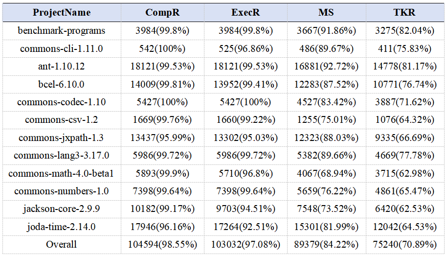
</p>

**表 4.** RIP-Evidence 的项目级测试生成结果。

<p align="center">
  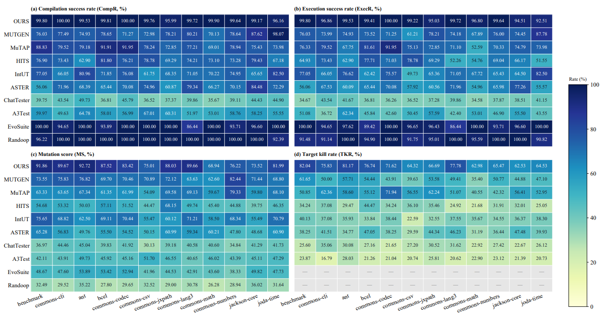
</p>

**图 4.** 不同测试生成方法在 CompR、ExecR、MS 和 TKR 上的项目级对比。

<p align="center">
  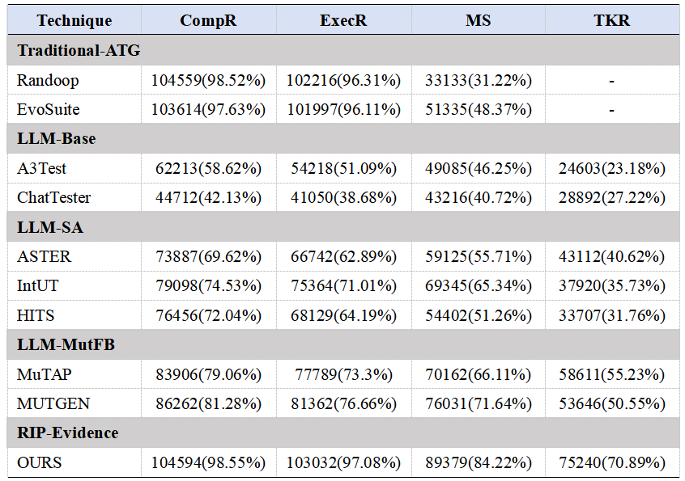
</p>

**表 5.** RIP-Evidence 与基线方法的总体有效性对比。

### RQ2：算子级杀死稳定性

在 19 个变异算子中，RIP-Evidence 在 18 个算子上优于对应的最强基线，并在剩余 1 个算子上持平。

<p align="center">
  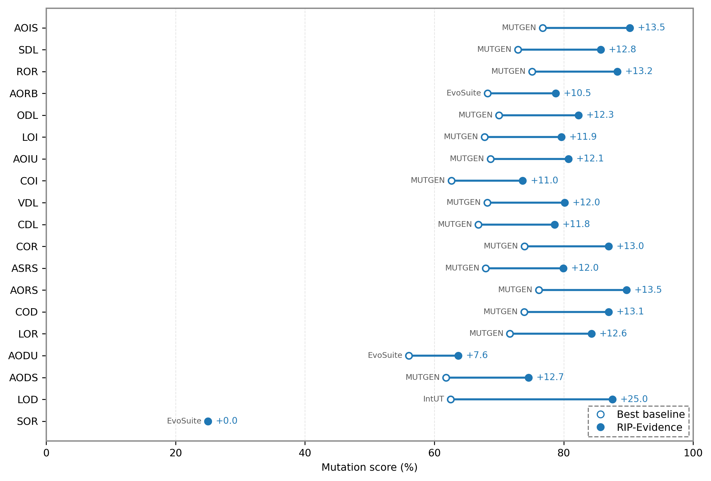
</p>

**图 5.** RIP-Evidence 与最优基线的算子级变异得分对比。

### RQ3：效率与成本

证据构造和 `PromptEvidence` 组装只引入有限开销；结构化证据与定向诊断则减少了重复修复。实验分别报告端到端时间、服务端 Token 使用量和推理成本。

<p align="center">
  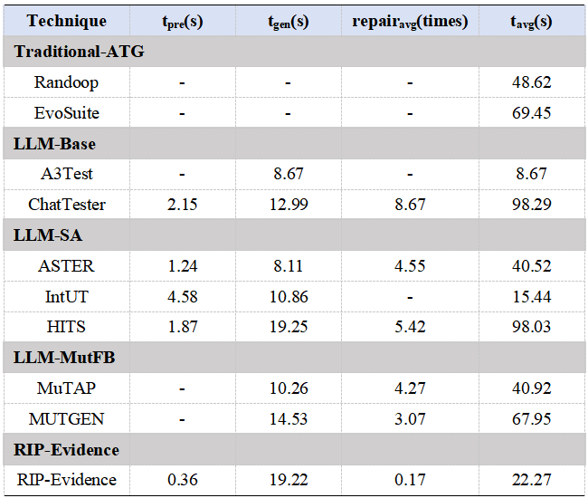
</p>

**表 6.** 不同测试生成方法的时间成本和修复开销。

<p align="center">
  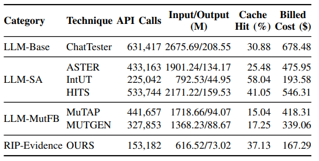
</p>

**表 7.** 不同测试生成方法的服务端 API 使用量与推理成本。

### RQ4：不同 LLM backbone 上的有效性

实验覆盖代码模型、开放权重模型和闭源模型。结果表明，证据框架并不依赖单一 backbone，但不同模型的绝对性能和修复开销仍存在差异。

<p align="center">
  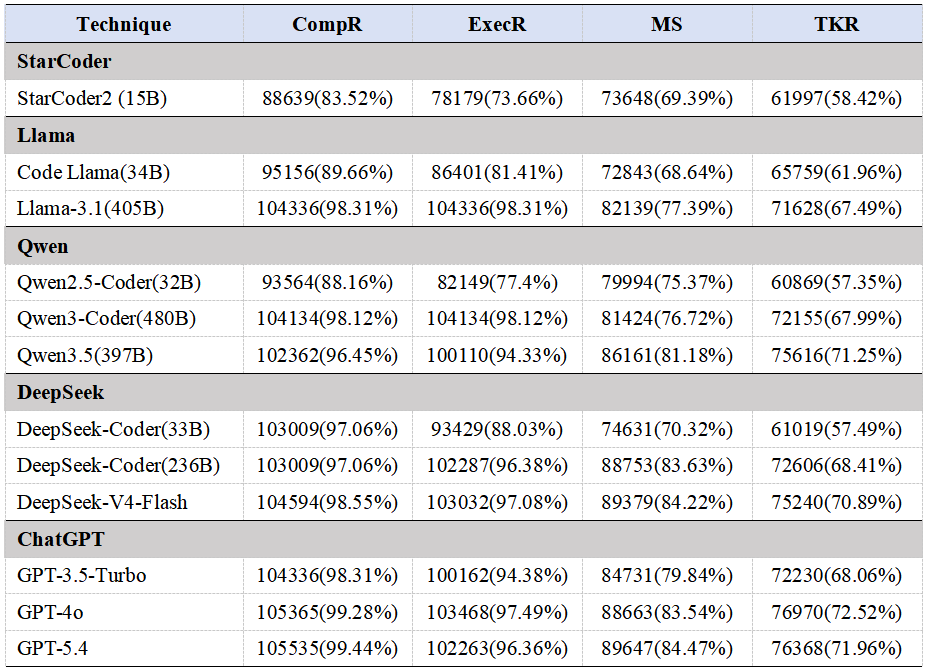
</p>

**表 8.** RIP-Evidence 在不同 LLM backbone 上的测试生成有效性。

<p align="center">
  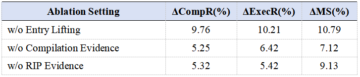
</p>

**表 9.** 不同 LLM backbone 的效率和修复开销。

<p align="center">
  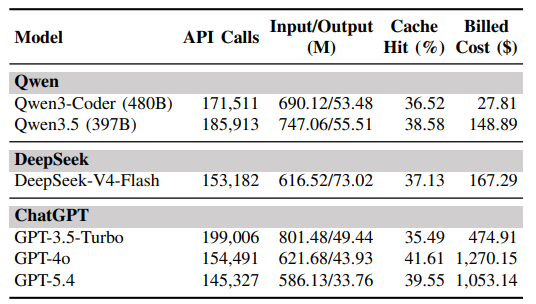
</p>

**表 10.** 不同 LLM backbone 的服务端 API 使用量与推理成本。

<p align="center">
  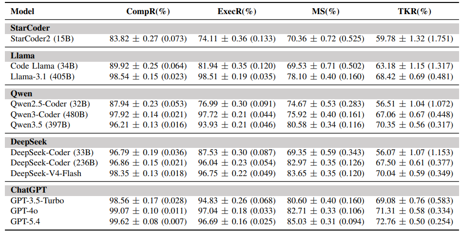
</p>

**表 11.** 不同 LLM backbone 的重复运行稳定性；结果以均值 ± 标准差报告，括号内为方差。

## 消融、预算、失败与真实缺陷

### 多源程序证据的整体贡献

在大多数被评估 backbone 上，加入结构化证据能够提高编译率、执行率和变异得分。消融结果也表明，同一种证据配置不一定对所有模型产生同等收益，因此需要考虑模型相关的证据预算与选择策略。

<p align="center">
  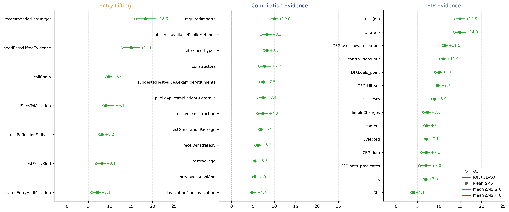
</p>

**图 6.** 多源程序证据对 LLM 测试生成的整体消融结果。

### 证据组件与字段

入口提升、编译证据和 RIP 证据均具有显著贡献。细粒度分析进一步突出可调用测试目标、必要 import、public API 约束、CFG/DFG 证据和可观察传播字段的重要性。

<p align="center">
  
</p>

**表 12.** 主要证据组件的消融结果。

<p align="center">
  
</p>

**图 7.** 各证据字段对变异得分的细粒度影响。

### Token 预算

预算实验评估在保持测试生成质量的同时，完整证据能够被压缩到何种程度。`PE-B` 表示目标证据预算为 `B` 个 Token 的 `PromptEvidence` 配置。

<p align="center">
  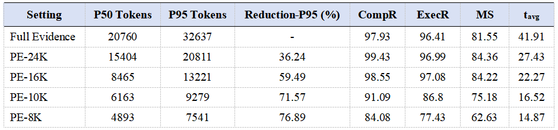
</p>

**表 13.** Token 预算对证据压缩与测试生成的影响。

### 失败模式

剩余失败主要涉及抽象类或接口测试桩不完整、类型/签名不匹配、非法 override、符号无法解析、private 访问、未处理 checked exception，以及生成测试未能暴露变异差异等情况。

<p align="center">
  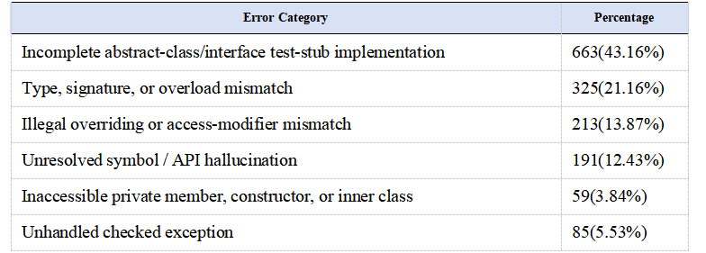
</p>

**表 14.** 测试生成失败案例分类。

### 真实缺陷检测

为检验面向变异体的定向生成能否迁移到合成变异之外，实验在严格映射且可执行的 Defects4J v3.0.1 缺陷上执行生成测试。RIP-Evidence 检测出其中 **64.29%** 的映射缺陷。

<p align="center">
  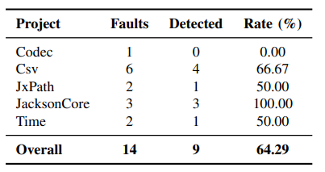
</p>

**表 15.** 严格映射且可执行的 Defects4J v3.0.1 真实缺陷检测结果。

## 可复现性说明

- MuJava 仍作为变异体生成和变异测试执行后端。
- `EvidenceParse/` 是多源程序证据构造的权威实现。
- `MuTestLLM/` 是证据压缩、LLM 生成、修复、执行和汇总的权威实现。
- `Baselines/` 通过隔离适配器和统一目标清单，确保所有方法在相同映射变异体上评估。
- 大规模证据构造应使用 process 模式；single 模式主要用于诊断。
- 为保证实验可审计，应保留 prompt、response、紧凑证据、编译诊断、执行日志和运行清单。
- 四个核心有效性指标均以非等价目标变异体集合为基础。

## 论文与数据

- 代码仓库：<https://github.com/hulei172418/MutantsTestLLM>
- 数据集：<https://doi.org/10.5281/zenodo.20593500>
