# RIP-Evidence

**Multi-Source Evidence-Guided Large Language Models for Mutation Unit Test Generation**

RIP-Evidence is an evidence-guided framework for generating Java unit tests that kill specific mutants. Instead of giving an LLM only source code or mutation feedback, it statically constructs the program evidence needed to **Reach** the mutation, **Infect** program state, **Propagate** the behavioral difference, and produce a compilable, observable JUnit test.

The repository contains the implementation, baseline reproductions, experiment data, and all **7 figures** and **15 tables** from the paper.

> Paper status: under review. The implementation and artifacts may continue to receive reproducibility-oriented updates.

## At a glance

- **Task:** target-specific mutation-killing unit test generation for Java.
- **Core idea:** combine mutation semantics, RIP evidence, callable-entry lifting, construction/API constraints, observable behavior, and compilation feedback into compact `PromptEvidence`.
- **Scale:** 125,157 mutants from 12 Java projects; 106,130 labeled non-equivalent mutants are generation targets.
- **Main results:** 98.55% compilation success, 97.08% execution success, 84.22% suite-level mutation score, and 70.89% target kill rate.
- **Improvement:** +17.27 percentage points in compilation success and +12.58 points in mutation score over the best comparable LLM baseline.
- **Real faults:** 64.29% detection rate on strictly mapped and executable Defects4J v3.0.1 faults.

## Abstract

Mutation testing evaluates whether tests can distinguish an original program from its mutants. Generating a test for a specific mutant is difficult because covering the mutated statement is insufficient: the test must reach the mutation, cause a divergent internal state, propagate that difference to an observable behavior, and express a valid oracle. Direct LLM generation is further affected by inaccessible methods, invalid object construction, hallucinated APIs, weak assertions, and compilation failures.

RIP-Evidence addresses these problems by statically constructing multi-source evidence about mutation semantics, invocation entries, receiver construction, available APIs, RIP conditions, and observable behavior. It compresses this evidence into `PromptEvidence`, guides an LLM to generate mutation-sensitive JUnit tests, and uses compilation and execution diagnostics for targeted repair.

## Method

### Motivation: killing a mutant requires more than coverage

The motivating example separates the real mutated method `A` from the callable entry `B`. A successful test must legally invoke `B`, reach and infect `A`, propagate the difference, and assert an observable outcome. Typical failures include directly calling an inaccessible method, choosing inputs that miss the mutation branch, and omitting an assertion that exposes the difference.

<p align="center">
  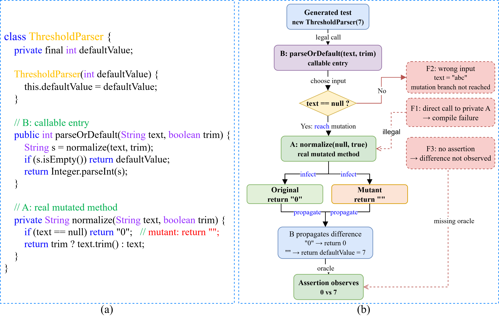
</p>

**Figure 1.** Invocation entry, propagation path, and typical failure modes in mutation unit test generation.

### End-to-end workflow

RIP-Evidence has four main stages:

1. **Mutation localization and candidate-region identification:** align source-level AST changes with affected Jimple statements in the original and mutant programs.
2. **Multi-source evidence construction:** build mutation semantics, CFG/DFG-based Reach–Infect–Propagate evidence, callable-entry information, receiver construction, public API constraints, and observable/assertion plans.
3. **Budget-aware `PromptEvidence` assembly:** prioritize mutation, invocation, oracle, and compilation-critical evidence while compressing repetitive paths and low-priority context.
4. **LLM generation and repair:** generate JUnit tests, compile them, classify failures, and issue targeted repair prompts.

<p align="center">
  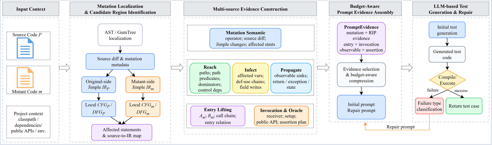
</p>

**Figure 2.** Overall workflow of the proposed framework.

### Entry lifting

When the real mutation method `A` is private, inaccessible, abstract, or reachable only through an indirect call chain, the framework searches for a legal callable entry `B`. It then constructs the call chain `B → A`, receiver/setup guidance, input constraints, observable sinks, and an assertion plan.

<p align="center">
  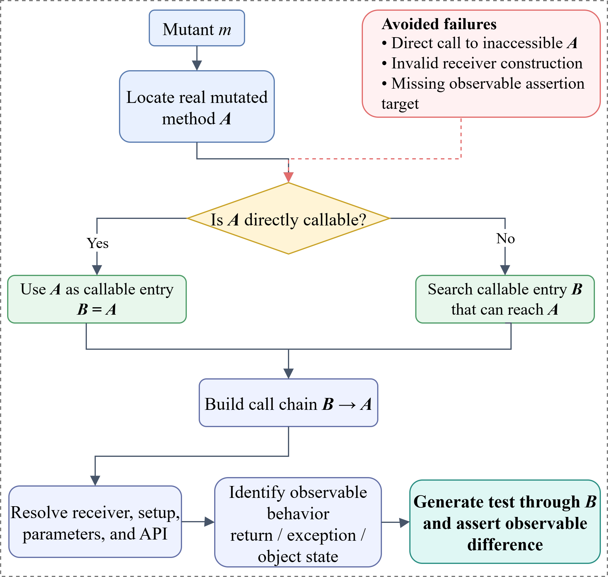
</p>

**Figure 3.** Entry-lifting mechanism for callable tests.

### Evidence hierarchy

`PromptEvidence` organizes evidence into a hierarchy rather than sending raw program-analysis output to the LLM.

<p align="center">
  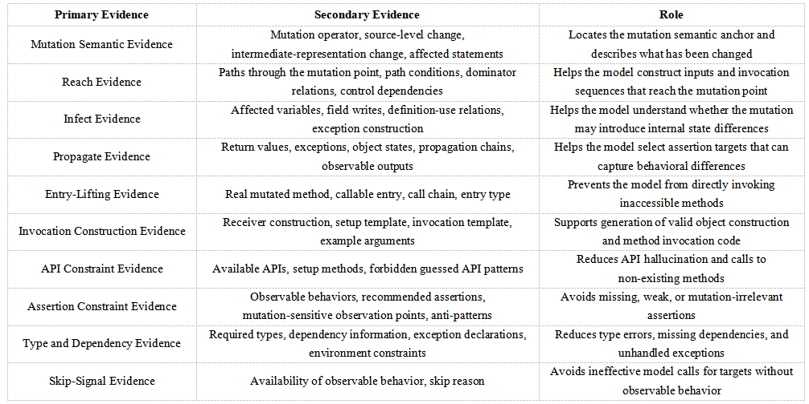
</p>

**Table 1.** Hierarchical organization of multi-source program evidence and its role.

## Repository layout

```text
MutantsTestLLM/
├── EvidenceParse/   # Multi-source evidence construction; emits graph/output.json
├── MuTestLLM/       # MuJava extension, PromptEvidence, LLM generation/repair/evaluation
├── Baselines/       # Seven LLM baselines and two traditional ATG baselines
├── data/            # Experiment workbooks, derived statistics, and analysis scripts
├── figs/            # Paper figures Fig1–Fig7 and tables Table1–Table15
├── README.md        # English documentation
└── README-zh.md     # Chinese documentation
```

Component documentation:

- [`EvidenceParse/README.md`](EvidenceParse/README.md): evidence schema, Excel input, batch modes, and `output.json` generation.
- [`MuTestLLM/README.md`](MuTestLLM/README.md): MuJava integration, LLM configuration, generation, compilation repair, execution, and result collection.
- [`Baselines/README_EN.md`](Baselines/README_EN.md): unified baseline protocol and English runbook.
- [`Baselines/data/README.md`](Baselines/data/README.md): target manifest and dataset fields.

## Requirements

The main implementation is designed for a Windows/PowerShell research environment and Java projects processed by MuJava.

- JDK 8 or a JDK compatible with the selected subject project
- Maven 3.x
- Python 3.8+ for baseline adapters and analysis scripts
- Sufficient memory for Soot analysis; large runs use `-Xmx16g` in the reference commands
- An OpenAI-compatible chat-completions endpoint for LLM-based generation
- Subject-project source, compiled classes, dependencies, and mutant directories

Do not commit API keys. Use the local ignored configuration files described in the component READMEs.

## Build

Build the two Java components from the repository root:

```powershell
mvn -f EvidenceParse/pom.xml clean package -DskipTests
mvn -f MuTestLLM/pom.xml clean package -DskipTests
```

Before a full run, configure the project-dependent paths and libraries in:

- `MuTestLLM/mujava.config`
- `MuTestLLM/mujavaCLI.config`
- `MuTestLLM/libraries.json`
- the local LLM properties described in `MuTestLLM/README.md`

For baseline experiments, copy and edit the templates under `Baselines/configs/` as documented in `Baselines/README_EN.md`.

## Reproduction pipeline

The Excel workbook is the central experiment index. It links each mutant to its project, source path, mutation operator, target method, generated evidence, generated test, and evaluation result.

### 1. Generate mutants

Use the MuJava entry points in `MuTestLLM` to generate and compile traditional method-level mutants:

```powershell
java -cp <classpath> mujava.TraditionalMutantsGeneratorCLI <args>
```

### 2. Construct `output.json` evidence

For large-scale runs, process mode provides worker isolation and amortizes Soot/JVM startup cost:

```powershell
java -Xmx16g -cp <evidence-classpath> org.OutputJsonBatchRunner `
  --excel <mutant-metadata.xlsx> `
  --mode process `
  --workers 8 `
  --rewrite true `
  --rowStart 1 `
  --rowEnd -1
```

Expected per-mutant artifact:

```text
<mutantDir>/graph/output.json
```

Use `--mode single` for debugging. See `EvidenceParse/README.md` for the Excel schema, exit codes, and logging layout.

### 3. Generate and compile JUnit tests

```powershell
java -Xmx16g `
  -Dmujava.config.path=<mujava.config> `
  -Dllm.provider=<provider> `
  -Dllm.threads=4 `
  -cp <mutest-classpath> `
  mujava.testgenerator.LLMTestGeneratorBatch <mutant-metadata.xlsx>
```

The generator reads `output.json`, constructs budget-aware `PromptEvidence`, calls the configured model, extracts Java code, compiles it, and performs targeted repairs when necessary.

### 4. Execute tests on original and mutant programs

```powershell
java -Xmx16g -cp <mutest-classpath> `
  mujava.testgenerator.LLMTestExecutor <mutant-metadata.xlsx> 5000
```

The second argument is the timeout in milliseconds. The executor reports target-level killing and suite-level mutation scores.

### 5. Collect results

Representative outputs are:

```text
<resultModuleHome>/llm/
├── src/
├── classes/
└── report/
    ├── llm_generation_results.jsonl
    ├── <TestName>__compact_evidence.json
    ├── <TestName>__prompt.txt
    ├── <TestName>__response_0.json
    ├── <TestName>__compile_error_0.txt
    └── <TestName>__generation_summary.txt

<resultModuleHome>/llm/execution-report/<runId>/
├── llm_target_kill_results.csv
├── llm_suite_kill_results.json
├── all_method_summary.csv
├── all_class_summary.csv
└── llm_execution_summary.txt
```

The detailed collector, restoration, and failure-analysis utilities are documented in `MuTestLLM/README.md`.

## Experimental design

### Research questions

- **RQ1 — Project-level effectiveness:** How usable and mutation-effective are the generated tests across projects and methods?
- **RQ2 — Operator-level stability:** Is killing performance stable across mutation operators?
- **RQ3 — Efficiency and cost:** What are the evidence, generation, repair, execution, token, and API costs?
- **RQ4 — Cross-model effectiveness:** Does structured evidence remain effective across different LLM backbones?

### Dataset

The evaluation uses 12 Java subjects containing 84,672 lines of code, 3,304 classes, and 8,137 methods. MuJava generates 125,157 mutants with 19 traditional operators. After excluding 19,027 labeled equivalent mutants, 106,130 non-equivalent mutants remain as test-generation targets.

<p align="center">
  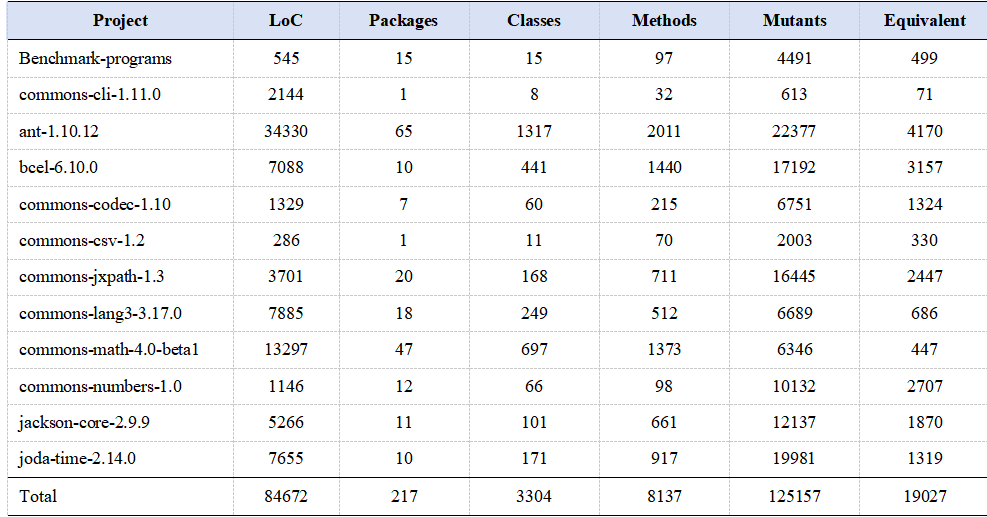
</p>

**Table 2.** Statistics of the subject projects and generated mutants.

<p align="center">
  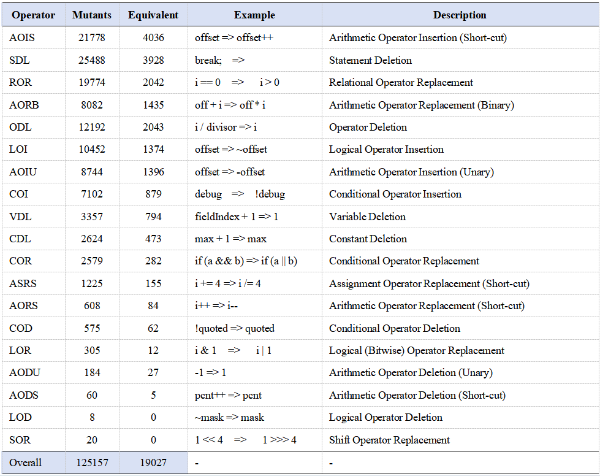
</p>

**Table 3.** Statistics of the mutation operators used in the study.

The released dataset is archived at [Zenodo (DOI: 10.5281/zenodo.20593500)](https://doi.org/10.5281/zenodo.20593500).

### Baselines

The comparison covers four method families and nine baselines:

| Family | Baselines |
|---|---|
| Traditional automated test generation | Randoop, EvoSuite |
| Basic LLM test generation | A3Test, ChatTester |
| Static-analysis-enhanced LLM generation | ASTER, IntUT, HITS |
| Mutation-feedback-enhanced LLM generation | MuTAP, MUTGEN |

All adapters, pinned source artifacts, configurations, target manifests, and run layouts are under `Baselines/`.

### Metrics

| Metric | Meaning |
|---|---|
| **CompR** | Percentage of target mutants for which the generated test compiles |
| **ExecR** | Percentage of targets for which the test executes successfully on the original program and yields a comparable result |
| **MS** | Suite-level mutation score over non-equivalent target mutants |
| **TKR** | One-to-one target kill rate: whether each generated test kills its corresponding target mutant |

MS evaluates the aggregate killing ability of the generated suite, whereas TKR evaluates directed target-specific killing.

## Results

### RQ1: project-level effectiveness

RIP-Evidence achieves **98.55% CompR**, **97.08% ExecR**, **84.22% MS**, and **70.89% TKR** overall. Compared with the strongest comparable LLM baseline, CompR increases by 17.27 percentage points and MS by 12.58 points.

<p align="center">
  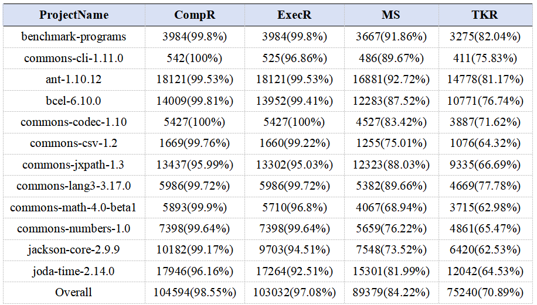
</p>

**Table 4.** Project-level test generation results of RIP-Evidence.

<p align="center">
  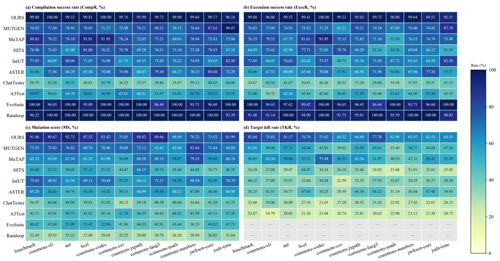
</p>

**Figure 4.** Project-level comparison of CompR, ExecR, MS, and TKR across test-generation methods.

<p align="center">
  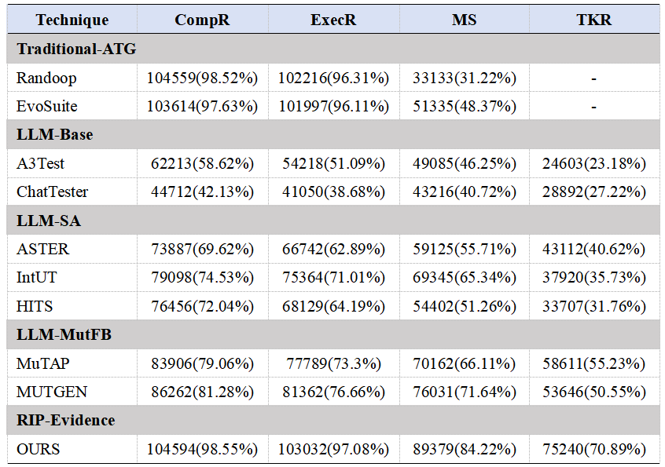
</p>

**Table 5.** Overall effectiveness comparison between RIP-Evidence and baseline methods.

### RQ2: operator-level killing stability

RIP-Evidence outperforms the strongest operator-specific baseline on 18 of the 19 mutation operators and ties on the remaining operator.

<p align="center">
  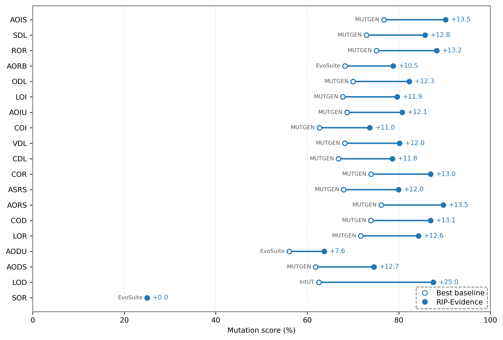
</p>

**Figure 5.** Operator-wise mutation score comparison between RIP-Evidence and the best baseline.

### RQ3: efficiency and cost

Evidence construction and `PromptEvidence` assembly add limited overhead, while structured evidence and targeted diagnostics reduce repeated repair. The study separately reports end-to-end time, provider-side token usage, and inference cost.

<p align="center">
  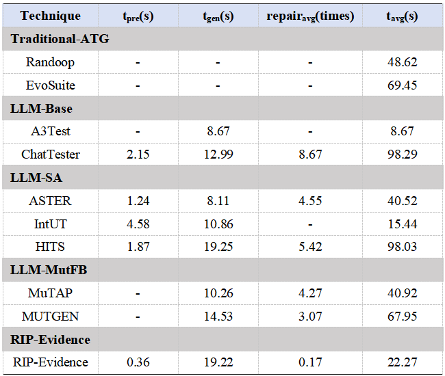
</p>

**Table 6.** Time cost and repair overhead of different test-generation methods.

<p align="center">
  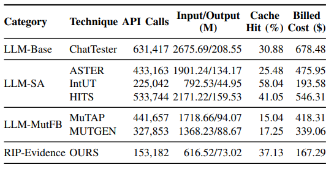
</p>

**Table 7.** Provider-side API usage and inference cost of different test-generation methods.

### RQ4: effectiveness across LLM backbones

The evaluation spans code-focused, open-weight, and proprietary LLMs. The results show that the evidence framework is not tied to a single backbone, although absolute performance and repair overhead vary with model capability.

<p align="center">
  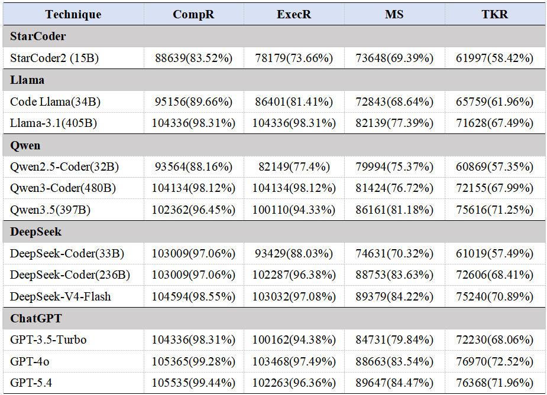
</p>

**Table 8.** Test-generation effectiveness of RIP-Evidence with different LLM backbones.

<p align="center">
  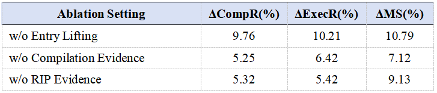
</p>

**Table 9.** Efficiency and repair overhead with different LLM backbones.

<p align="center">
  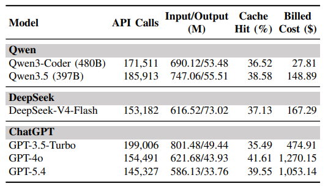
</p>

**Table 10.** Provider-side API usage and inference cost of different LLM backbones.

<p align="center">
  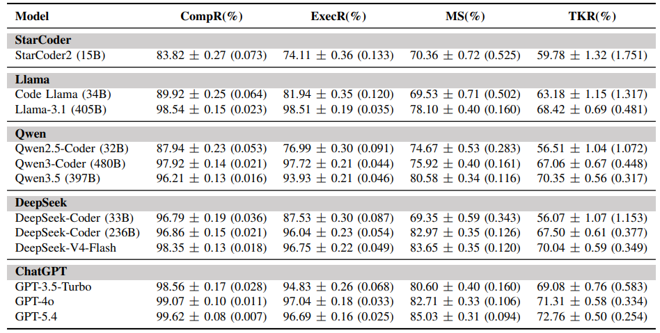
</p>

**Table 11.** Repeated-run stability across LLM backbones; values are reported as mean ± standard deviation, with variance in parentheses.

## Ablation, budget, failures, and real faults

### Overall contribution of multi-source evidence

Across most evaluated backbones, adding structured evidence improves compilation, execution, and mutation scores. The ablation also shows that a single evidence configuration may not benefit every model equally, motivating model-aware budgeting and selection.

<p align="center">
  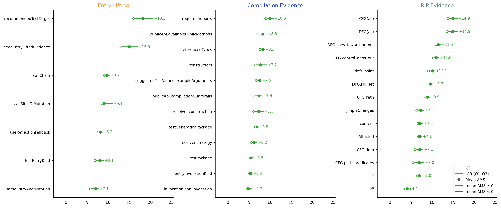
</p>

**Figure 6.** Ablation of multi-source evidence on LLM-based test generation.

### Evidence components and fields

Entry lifting, compilation evidence, and RIP evidence all make substantial contributions. Fine-grained analysis highlights callable test targets, required imports, public API constraints, CFG/DFG evidence, and observable propagation fields.

<p align="center">
  
</p>

**Table 12.** Ablation results of major evidence components.

<p align="center">
  
</p>

**Figure 7.** Fine-grained impact of evidence fields on mutation score.

### Token budget

The budget study evaluates how aggressively full evidence can be compressed while preserving test-generation quality. `PE-B` denotes a `PromptEvidence` configuration with a target budget of `B` tokens.

<p align="center">
  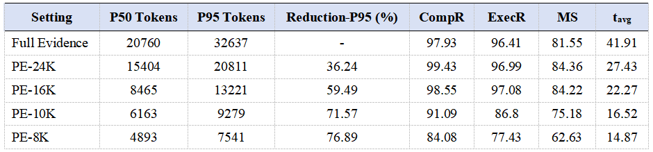
</p>

**Table 13.** Effect of token budgets on evidence compression and test generation.

### Failure modes

Remaining failures mainly involve incomplete stubs for abstract classes or interfaces, type/signature mismatches, invalid overrides, unresolved symbols, private access, unhandled checked exceptions, and cases in which the generated test does not expose the mutation difference.

<p align="center">
  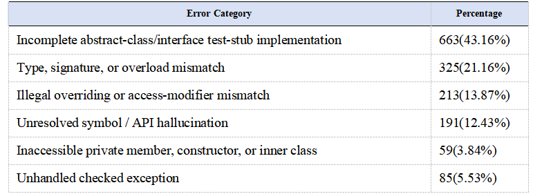
</p>

**Table 14.** Categorization of failed test-generation cases.

### Real-fault detection

To test whether mutation-directed generation transfers beyond synthetic mutants, generated tests are evaluated on strictly mapped and executable Defects4J v3.0.1 faults. RIP-Evidence detects **64.29%** of these mapped faults.

<p align="center">
  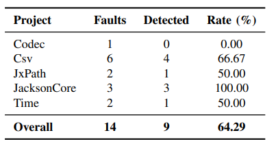
</p>

**Table 15.** Real-fault detection results on strictly mapped and executable Defects4J v3.0.1 faults.

## Reproducibility notes

- MuJava remains the mutation-generation and mutation-execution backend.
- `EvidenceParse/` is the authoritative implementation of multi-source evidence construction.
- `MuTestLLM/` is the authoritative implementation of evidence compression, LLM generation, repair, execution, and aggregation.
- `Baselines/` uses isolated adapters and a unified target manifest so that all methods are evaluated against the same mapped mutants.
- Large-scale evidence construction should use process mode; single mode is intended for diagnosis.
- Preserve prompts, responses, compact evidence, compiler diagnostics, execution logs, and run manifests for auditability.
- Equivalent mutants are excluded from the denominators of the four core effectiveness metrics.

## Paper and data

- Repository: <https://github.com/hulei172418/MutantsTestLLM>
- Dataset: <https://doi.org/10.5281/zenodo.23935508>
- Local paper copy: [`Baselines/ReferencePapers/MutantsTestLLM.pdf`](Baselines/ReferencePapers/MutantsTestLLM.pdf)

## Citation

If you use this repository, please cite the paper. Replace the venue metadata below with the final bibliographic record after publication.

```bibtex
@article{hu2026ripevidence,
  title   = {Multi-Source Evidence-Guided Large Language Models for Mutation Unit Test Generation},
  author  = {Hu, Lei and Yao, Xiangjuan and Wei, Changqing and Gong, Dunwei and Wu, Jie},
  journal = {Under Review},
  year    = {2026}
}
```

RIP-Evidence builds on MuJava:

```bibtex
@inproceedings{ma2006mujava,
  title     = {MuJava: A Mutation System for Java},
  author    = {Ma, Yu-Seung and Offutt, Jeff and Kwon, Yong-Rae},
  booktitle = {Proceedings of the 28th International Conference on Software Engineering},
  pages     = {827--830},
  year      = {2006}
}
```

## Contact

- Lei Hu: `hulei172418@gmail.com`
- Xiangjuan Yao (corresponding author): `yaoxj@cumt.edu.cn`
- Changqing Wei (corresponding author): `weicq@aust.edu.cn`
